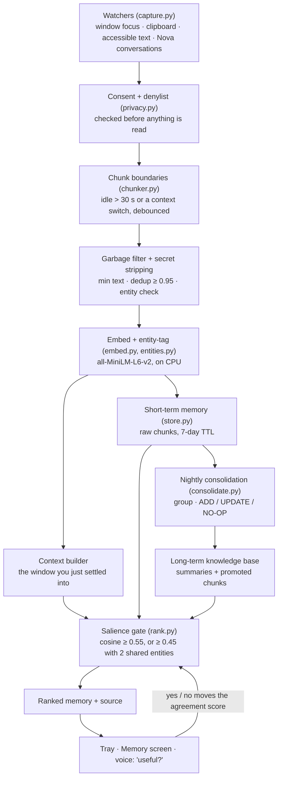

# AfterThought: Nova's proactive memory

AfterThought is the layer that lets Nova speak first. It remembers what you work on, in
the apps you allow, and when what's in front of you connects to something you did
before, it brings that memory up with its source attached. You don't have to search.

It started as a hackathon design (*AfterThought — AHI Hackathon Submission*, Team
Localhost, Rendezvous '26) for a tray app. Nova already has a voice, so here a strong
match is also asked out loud ("useful?"), and you answer by speaking. That answer is the
accept/dismiss signal the design learns from.

> **The rules it follows.** Nothing is watched until you switch an app on. Capture,
> embedding and retrieval run on this PC with zero network calls. Silence is the
> default: below the similarity gate, nothing is said. Short-term memory expires after
> seven days unless it earns its keep.

## How it fits together

Each box in Figure 1 below is one module under `assistant/afterthought/`. Two paths
leave the watcher: one *keeps* (left), one *speaks up* (right).



*Figure 1: The AfterThought pipeline. Consent is enforced at the watcher, before the
chunker, so an excluded window never becomes a memory that would later need deleting.*

## What each stage does

| Stage | Module | What it does |
|---|---|---|
| Watchers | `capture.py` | Every 2 s: the foreground window (process + title), the clipboard (only when its sequence number changes), and every 15 s the focused window's text through UI Automation, capped at 4,000 characters and 1.5 s. Your exchanges with Nova are kept too. |
| Consent | `privacy.py` | Password managers, banking and payment pages, sign-in and OTP screens, `.env` files and incognito/InPrivate windows are skipped before their title is used. Clipboard content that password managers mark as private is never read. Everything else needs the app switched on. |
| Chunking | `chunker.py` | A chunk ends after 30 s idle or when you switch context. Under 20 s in a window counts as passing through. |
| Filter | `service._ingest` | Secrets are stripped (passwords, card numbers, OTPs, API keys, JWTs, private keys). A chunk with under 40 characters of text is dropped unless it lasted two minutes and names something. A near-duplicate (≥ 0.95) of a recent chunk extends that chunk instead of adding a new one. |
| Embed + tag | `embed.py`, `entities.py` | 384-dimension MiniLM vectors, normalised. Entity tags are emails, handles, tickets, files, domains, money, dates, capitalised names, and the people and projects in your profile. |
| Store | `store.py` | One SQLite file, `data/afterthought.db`. Vectors sit in a numpy matrix, so search is one matrix multiply (well under a millisecond for thousands of rows). Not ChromaDB: at this size, a new dependency buys nothing. |
| Consolidation | `consolidate.py` | Nightly at 3:00, or on the next start if the PC was off. Groups the day's chunks by meaning and shared entities, then applies Mem0's write logic: UPDATE an existing entry (similarity ≥ 0.7), ADD a new one, or NO-OP (a lone, unimportant chunk just expires). Summaries are extractive, so nothing in the knowledge base was written by a model. |
| Early promotion | `consolidate.promote` | A chunk recalled or accepted twice goes to long-term memory immediately. "Remember this" goes there directly. |
| Trigger | `service._trigger` | Once you've settled into a new context (20 s), it runs a search. It excludes what you're looking at, what you did in the last 30 minutes, and anything already brought up in the last 6 hours. At most one suggestion every 3 minutes. |
| Ranking | `rank.py` | Gate first, then `(0.5·recency + 3·relevance + 2·importance + 1.5·agreement) / 7`. Recency has a 72-hour half-life. Agreement is `(accepted + 1) / (accepted + dismissed + 2)`. |
| Display | `service._suggest` | A tray notification, the top of the Memory screen, and if the match is strong (≥ 0.65) and Nova is idle, a spoken question that ends in "useful?". |

## Why the gate is 0.55 and not 0.75

The deck's 0.75 assumed a stronger model. With all-MiniLM-L6-v2, measured on this
machine against the deck's own worked example, Table 1 shows what the scores really are:

| Pair | Cosine |
|---|---|
| Standup note ↔ follow-up email to the same client about the same rollout | 0.65 |
| Best single sentence of the note ↔ the email | 0.63 |
| Unrelated text (groceries, cricket, a deploy) ↔ the email | 0.13 – 0.18 |
| Unrelated text ↔ any sentence of the note | 0.15 – 0.24 |

*Table 1: Measured MiniLM similarities. Related text tops out near 0.65 and unrelated
text stays under 0.25, so a 0.75 gate would never fire and 0.55 still leaves a wide margin.*

So the gate is 0.55, or 0.45 when two entities match (a tag like "acme corp" also matches
"client acme corp"). Both are in `[afterthought]` if you want to tune them.

## Using it

**Switch apps on** (nothing is watched until you do):

| Say | Effect |
|---|---|
| "remember what I do in Chrome" / "… in VS Code" | Watch that app |
| "stop remembering what I do in Chrome" | Stop, from now on |
| "what apps are you watching" / "memory status" | What's on, and how much is kept |

Or use the switches on the **Memory** screen (canvas → Memory).

**Ask and keep:**

| Say | Effect |
|---|---|
| "remember this" / "remember this as the Acme decision" | The window in front of you (title, text, clipboard) goes straight to long-term memory |
| "what do you remember about the payments rollout" | Searches memory and answers with where and when it came from |
| "what did we decide about Acme" | Same |

"Remember **that**" still means "save that as an automation" (AGENTS.md section 12).
"Remember **this**" is memory.

**When Nova brings something up:**

| Say | Effect |
|---|---|
| "yes" / "that's useful" | The memory ranks higher; two references promote it to long-term |
| "no" / "not useful" | The memory ranks lower for this kind of moment |
| "forget that memory" | Deletes it |
| "pause suggestions for 2 hours" / "resume suggestions" | Keeps remembering, stops speaking up |

**Agents** get the `recall_memory` and `remember_note` tools (Groq/OpenRouter). Claude sessions use the shell:

```
python main.py memory search "payments rollout"
python main.py memory remember "Acme rollout moved to Oct 15"
python main.py memory status | watch Chrome | unwatch Chrome | forget <id> | consolidate
```

## The Memory screen

The canvas's **Memory** tab shows, on the left:

- what was brought up, with **Useful** and **Not useful** buttons;
- every long-term entry, filterable, each with its entity tags and sources and a **Forget** button;
- the raw recent chunks.

On the right: a search box, the per-app switches, and the model, gate and counts. It also
has **Consolidate now** and **Forget everything**.

## Settings (`[afterthought]` in config.toml)

| Key | Default | Meaning |
|---|---|---|
| `threshold` | 0.55 | similarity that gates a suggestion |
| `voice_threshold` | 0.65 | strong enough to also be asked out loud |
| `cooldown_seconds` | 180 | at most one suggestion per this long |
| `capture_clipboard`, `capture_text`, `remember_conversations` | true | which watchers run (for switched-on apps) |
| `deny_apps`, `deny_titles` | [] | added to the built-in denylist |
| `short_term_days` / `promote_refs` | 7 / 2 | TTL, and how many references promote early |
| `model` | all-MiniLM-L6-v2 | `"hashing"` runs with no model at all, much weaker |

## What is deliberately not here

- **No screenshots or OCR.** Text comes from the accessibility tree, the same one a screen
  reader uses. Apps that don't expose text (some games, remote desktops) give titles only.
- **No model writes memories.** Summaries are extractive. A model sees memory only when you
  ask an agent something and it calls `recall_memory`.
- **No per-app overlay.** The deck's fallback, a single panel plus the tray, is what ships,
  with voice on top.
