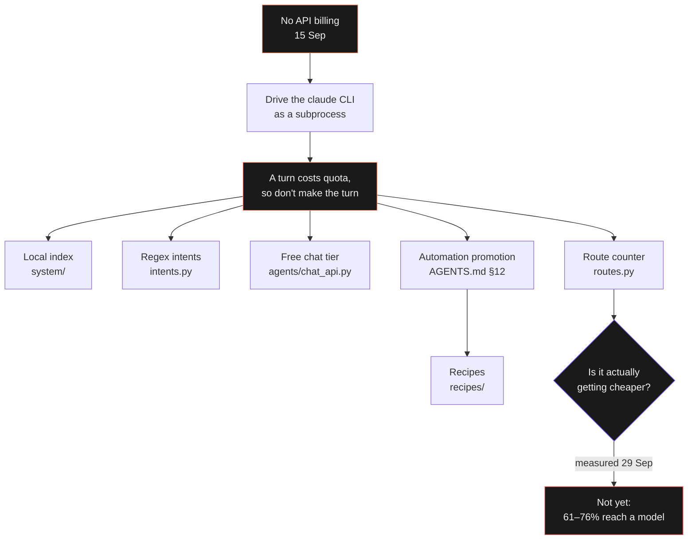
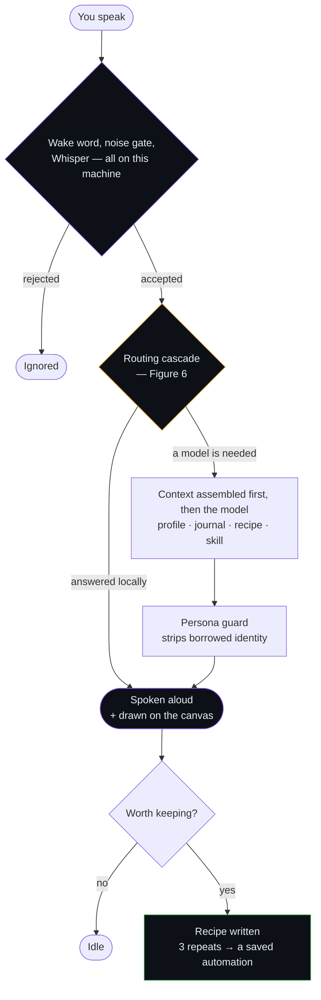
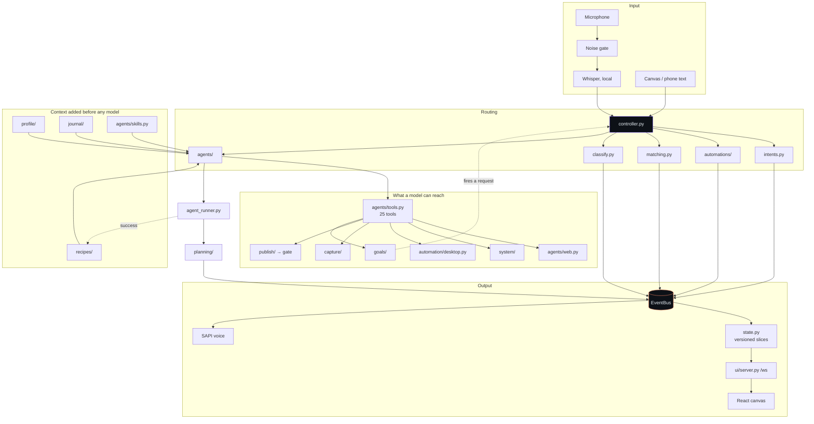
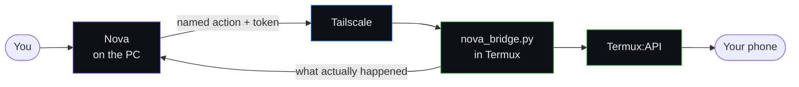
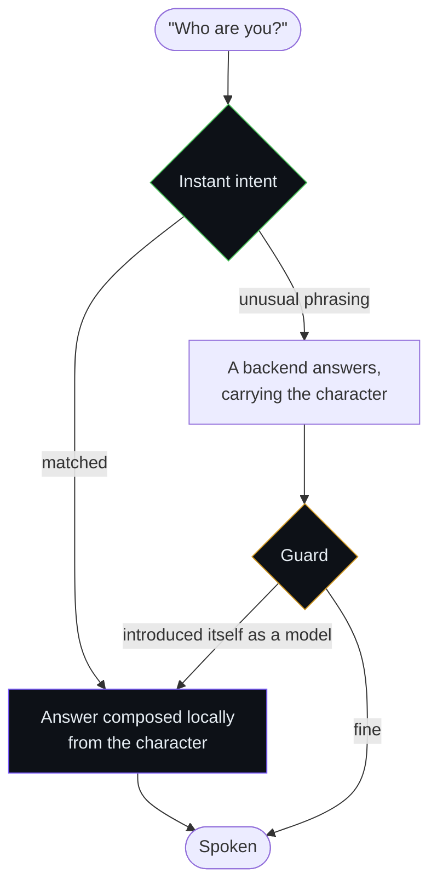
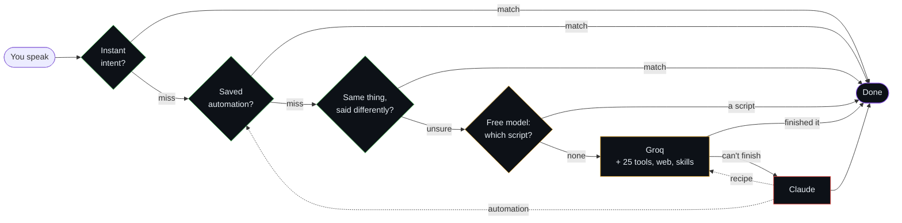
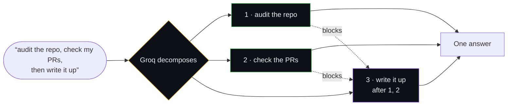
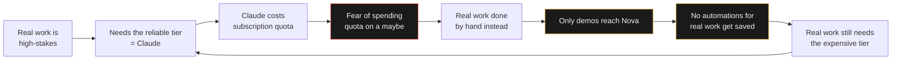

# Nova — Project Status Report

| | |
|:--|:--|
| **Project** | Nova / AssisstantOS — a local voice assistant that executes, plans and remembers |
| **Location** | `C:\Assisstant` · Python 3.11 · Windows 11 |
| **Author** | Aakshant Kumar |
| **Report date** | 29 September 2026 |
| **Period covered** | 15 September – 29 September 2026 (15 days) |
| **Version** | 1.0 |
| **Status** | Active development · working tree uncommitted (21 files) |
| **Companion documents** | [`EVOLUTION.md`](../EVOLUTION.md) (causal history, phases 1–9) · [`README.md`](../README.md) (what it is, how to run it) · [`AGENTS.md`](../AGENTS.md) (the rules agents follow here) |

---

> ### Executive Summary
>
> In fifteen days Nova went from a single script that piped speech into a CLI to a
> **19,000-line, 119-module system** with 658 tests, eleven subsystems, a React canvas, a
> phone bridge and a three-tier model cascade. The engineering is substantially complete
> and unusually well documented for its age. **The product is not yet adopted by its own
> author**, and this report argues that this — not any missing feature — is the finding
> that matters.
>
> **Key metrics**
>
> | | Start (15 Sep) | Now (29 Sep) |
> |:--|--:|--:|
> | Python modules | — | **119** |
> | Lines of Python | 5,758 | **18,976** |
> | Tracked files | 91 | **326** |
> | Tests | **0** | **658** |
> | Commits | 1 | **84** |
> | Saved automations | 0 | **17** |
> | Documentation | 0 | **3,298 lines** across 15 files (before this report) |
>
> **Three critical findings**
>
> 1. **The cost claim is now measured, and it does not yet hold.** The design is organised
>    around "Nova gets cheaper the longer you use it." Between 61% and 76% of requests in
>    the most recent week reached a model. The direction of travel was also wrong: the free
>    share *fell* week over week.
> 2. **The instrument was broken, which is why nobody knew.** Every model turn was counted
>    twice, and the `agent` bucket never recorded *which* model ran — so the central claim
>    was not merely unmeasured, it was unmeasurable from its own data. Both are fixed in
>    this reporting period.
> 3. **The token fear that blocks adoption was a bug, not a law of nature.** A quadratic
>    resend in the chat loop made a ten-round turn carry 182,000 characters where it
>    needed 5,000 — a **35× overcharge** against an 8,000-tokens-per-minute free tier.
>    Fixed and regression-tested. The unreliability that pushed work toward Claude was
>    substantially self-inflicted.

---

## 1. Scope, Methodology and Sources

This report is reconstructed from primary evidence rather than recollection. Specifically:

| Source | Volume | What it established |
|:--|:--|:--|
| Git history | 84 commits, 15–24 Sep | What was built and in what order |
| Claude Code session transcripts | 67 sessions, 89 MB | What was *asked*, in the user's own words |
| Extracted user messages | 318 messages, 43,500 chars | The decision history and every complaint |
| `data/routes.json` | 2 ISO weeks, 143 records | The cost measurement |
| `data/task_frequency.json` | 23 task types | Which requests repeat |
| Test suite | 658 tests | What is actually verified |
| `data/` on disk | 62 MB | Growth and retention behaviour |

**Method.** Transcripts were parsed programmatically to extract only user-authored turns
(excluding tool results, system reminders and injected skill text), deduplicated, and
ordered chronologically. Quotations are verbatim, including the transcription errors,
because those errors are themselves part of the record.

**Assumptions and their limits.** Two figures in this report are bounded rather than
exact. The corrected free-share range in §5 depends on how many agent requests were
queued rather than started, which the old data cannot distinguish — so a range is given
instead of a point. Character counts are used as a token proxy at roughly four characters
per token; the provider's own `usage` figures are now recorded and will supersede the
proxy from this week forward.

---

## 2. How It Began: One Sentence That Set the Architecture

The first request, 15 September, 10:08:

> *"Script files and modules in chunks so that they remain maintainable and write a python
> program for calling speech recognition and quick resposne system and hooking it up with
> antigravity cli or claude cli whichever whenever we want to automate the work while we
> say and plan it visualizes things responds naturally and all"*

Forty minutes later, after a first attempt reached for an API key, came the correction
that determined everything downstream:

> *"no well we can't actually use api for that i need billing i wanted to connect claude
> code so that anything we say it executes which is the only possible way on my current
> p[lan]"*

**There is no Anthropic API billing on this machine.** Claude is reached by driving the
`claude` CLI as a subprocess. A request therefore costs a *subscription turn*, not cents —
and the only way to reduce that cost is to not make the request. Every cheap tier in this
system exists because of that sentence: local speech, a local SQLite index, regex intents,
a free chat tier, saved automations, recipes.

As Figure 1 shows, the causal chain from that one constraint reaches almost every
subsystem in the repository — which is why a report on Nova's progress is largely a report
on how well that chain is holding.



**Figure 1: The founding constraint and its consequences** — Every cheap path in Nova
descends from the absence of API billing. The measurement at the bottom of the chain is
the one that had never been taken until this reporting period, and it is currently
negative.

---

## 3. Development Timeline: Eleven Phases

Development came in bursts rather than evenly. Commits cluster on three days (45 on 20
September, 30 on 23 September, 8 on 24 September) because work was done live by voice and
committed in batches afterward.

| Phase | Date | Trigger (user's words, abridged) | What was built |
|:--|:--|:--|:--|
| **1** | 15 Sep | *"hooking it up with antigravity cli or claude cli"* | Speech → CLI, plan parsing, first canvas. 91 files, 0 tests |
| **2** | 16 Sep | A day of garbage transcripts from a TV in the room | Noise gate (`audio/gate.py`), wake word, Groq added, Fish Audio removed for rate limits |
| **3** | 17 Sep | *"suggest some improvements like state management better and adding personlaization"* | Versioned state slices, profile system, frecency ranking, timed history sessions |
| **4** | 18 Sep | *"teach yourself to pause or play a song in spotify…"* | TOML automations, automation promotion loop, "Living Ink" canvas redesign |
| **5** | 19 Sep | *"can you control my phone"* | Termux bridge over Tailscale, named actions only, token auth, SMS/calls behind confirmation |
| **6** | 20 Sep | *"so what exactly am I talking to here?"* | Three-layer persona, identity handling, intent classifier, loose matching, route counter |
| **7** | 22 Sep | *"a proper human artificial human… its own identity in this world"* | Journal, standing goals, capture, publishing gate, persona drift check |
| **8** | 22–23 Sep | *"use less and less of claude"* | Groq as front door, web search + page reader for chat models, skills shared, recipes, escalation ladder |
| **9** | 23 Sep | *"so can now we have an orchestrator"* | Orchestrator over the plan DAG: many steps, one answer |
| **10** | 28 Sep | *"we need a watcher that always has the information that what command is being run or ran last"* | `watcher.py` — one live index answering "what are you doing" for voice, canvas, phone and the `nova_status` tool |
| **11** | 29 Sep | *"optimize the code and disk management by adding caps"* | Token budgets, disk caps, route measurement repaired. **This report.** |

Phases 1–9 are documented causally in [`EVOLUTION.md`](../EVOLUTION.md). Phases 10 and 11
are new and are covered in §7 and §8 of this report.

---

## 4. What Exists Now

Nova is not a wrapper around a model. It is a routing system in which the model is the
last resort. Figure 2 traces a single request end to end, from the microphone to the
spoken answer and the record kept afterwards.



**Figure 2: One request, end to end** — Two filters precede any processing, and both run
locally, so nothing leaves the machine without the wake word. The routing decision is
expanded in Figure 6. The final branch is the one this report is ultimately about: it is
where a completed request becomes a recipe and, after three repeats, an automation that
needs no model again.

### 4.1 Architecture

The module structure follows the same principle. Modules communicate through `EventBus`
topics rather than through each other's interfaces, and state reaches the canvas as
versioned slices — only what changed, and only new rows for lists. The layout on disk:

```
main.py                   CLI flags and sub-commands -> Settings -> VoiceAssistant
sysindex.py               local index CLI, usable from any folder
canvas/                   React + dagre frontend (npm run build -> assistant/ui/canvas_dist)
phone/nova_bridge.py      the Termux listener that runs on the phone
automations/              saved TOML automations
packaging/                nova.spec + build.ps1 (PyInstaller)

assistant/
  app.py                  wiring: worker thread for input, main thread for window/tray
  controller.py           wake word -> the four tiers -> agent; queues, planning mode
  intents.py              regex command matching (~0 ms, no model call)
  matching.py             the same request said differently (filler, synonyms, order)
  classify.py             free-model router, grounded in the scripts that exist
  routes.py / stats.py    which tier answered, counted by week
  triage.py               errand or big job
  watcher.py              what is running now, and what ran last
  agent_runner.py         parallel turns, plan markers, step inference
  events.py / state.py    pub/sub bus and the slices the UIs render
  persona/                character.md, seed.md, guard.py -- who Nova is
  audio/                  microphone, transcriber, tts, gate
  agents/                 claude_cli, antigravity_cli, chat_api, tools, rules, registry
  planning/               plan.py (DAG + markers), graph.py (live nodes and edges)
  orchestrate/            one request, several steps, a single answer
  automation/             macros, desktop (UI Automation), browser (Playwright),
                          office (Word), promotion (writes itself out of the job)
  system/                 SQLite index: db, indexer, apps, search, ranking, duplicates
  profile/ history/       who you are; timed work sessions, search, recap
  awareness/ ambient/     window-title activity; weather, markets, headlines
  phone/                  the PC half of the phone bridge
  ui/                     server (FastAPI + WebSocket), auth (shared secret),
                          shell (window + tray), win32 (hotkey, single instance)
```

Figure 3 overleaf shows how those parts connect at run time.



**Figure 3: System architecture** — Note the two dotted edges: a successful run writes a
recipe, and a standing goal can originate a request without the user speaking. Everything
in the "Context" group is assembled before any model is invoked, which is what makes a
weak free model usable for work a stronger one would otherwise be needed for.

### 4.2 Subsystem inventory

| Area | Module | State |
|:--|:--|:--|
| Speech in / out | `audio/` | Local faster-whisper + SAPI, Fish Audio streaming in front. Working |
| Noise gate | `audio/gate.py` | Drops garbage transcripts on Whisper log-prob. Working |
| Instant commands | `intents.py`, `controller.py` | Regex → handler. Working |
| Loose matching | `matching.py` | Recognises a known script said differently. Working |
| Free classifier | `classify.py` | Groq picks a script when rules can't. Working |
| Agent backends | `agents/` | Claude CLI, Antigravity CLI, Groq, OpenRouter. Working |
| Task pool & triage | `agent_runner.py`, `triage.py` | Parallel tasks, errand/big-job split. Working |
| Orchestrator | `orchestrate/` | Step DAG, one answer. **Built but unreachable — see §6.1** |
| Plan graph | `planning/` | Live DAG with per-task lanes. Working |
| Watcher | `watcher.py` | Live "what is running" index. **Uncommitted** |
| Local index | `system/` | SQLite + FTS5 trigram, frecency ranking. Working |
| Automations | `automation/`, `automations/` | 17 saved TOML scripts. Working |
| Promotion loop | `automation/promotion.py` | Counts repeats, proposes automations. Working |
| Recipes | `recipes/` | Feeds back what worked last time. Working |
| Profile | `profile/` | Per-section visibility per agent. Working |
| History | `history/` | Timed sessions, search, recap. Working |
| Awareness | `awareness/` | Window-title probe folded into sessions. Working |
| Journal | `journal/` | One entry per finished day, fed back. Working |
| Standing goals | `goals/` | Unprompted queue, quiet hours. Working |
| Phone bridge | `phone/` | Termux over Tailscale, named actions only. Working |
| Publishing | `publish/` | GitHub, LinkedIn, Instagram behind one gate. Working |
| Capture | `capture/` | Screen record, phone camera, local edit. Partly untested |
| Canvas | `ui/`, `canvas/` | React, 15 screens, "Living Ink" direction. Working |
| Persona | `persona/` | Three layers + drift check. Working |
| Route counter | `routes.py` | **Repaired this period — see §5** |

### 4.3 The phone as a peripheral

An Android phone is reachable as part of the assistant, but deliberately not as a general
computer. The listener speaks a fixed vocabulary of named actions and exposes no
"run a command" endpoint, and it is reachable only over Tailscale.



**Figure 4: The phone bridge** — The return edge is the one that had to be added after the
fact. `termux-telephony-call` exits zero whether or not Android placed the call, so Nova
reported "Calling now" for calls that never happened. It now reads the phone's real call
state and has three answers, the third being the important one: *calling*, *dropped and
why*, or **"I can't tell"**.

### 4.4 Identity

Every backend has an identity from training, so a persona prompt only argues with it.
Nova handles this in three layers that mirror the cascade itself — matched locally first,
and a guard behind the model rather than an instruction in front of it.



**Figure 5: Identity in three layers** — The same principle as §6: the common phrasings are
matched locally and never reach a model, and what a model does return is checked rather
than trusted. One boundary is deliberate — the guard replaces a backend introducing itself
as a model, but leaves an honest answer about what Nova runs on alone.

---

## 5. Finding 1: The Cost Claim, Measured for the First Time

`EVOLUTION.md` closed on 23 September with an explicit open question: *"The next
measurement that matters is whether `stats --routes` bends downward."* It had never been
run. This period ran it — and first had to repair it, because the instrument was broken in
two ways.

Figure 6 states the claim being tested. Six tiers, cheapest first; but the two dotted
edges are the actual argument, because they are the only mechanism by which work moves
*down* the cascade over the system's life rather than remaining at the top of it forever.



**Figure 6: The cascade, and the two edges that are supposed to make it cheaper** — Four
free tiers precede the first model call and a fifth free tier precedes the only paid one.
When Claude does solve something it leaves the answer behind: a recipe so Groq can do it
next time, and after three repeats a saved automation needing no model at all. The
measurement below asks whether those dotted edges have carried any load yet.

### 5.1 The instrument was wrong

**Every model turn was counted twice.** `controller.handle` published a `route` event
announcing that it was about to use an agent, and `controller.dispatch` published a second
one recording the agent it actually used. Both were counted. The measured free share was
therefore roughly half of the true figure, for the entire life of the file.

**The `agent` bucket never said which agent.** The two hot dispatch sites passed
`name=""`, so a Groq turn and a Claude turn were indistinguishable in the data. This means
the claim the file exists to settle — *"Groq handles most of it now"* — was not merely
unmeasured but **unmeasurable from its own records**. Only `dispatch` carried the backend
name, and its event was the one being double-counted alongside an anonymous duplicate.

Both faults are fixed, and both are now regression-tested (`tests/test_routes.py`, 17
tests). An agent turn is recorded as `agent:groq`, `agent:openrouter` or `agent:claude`.

### 5.2 What the data says

| ISO week | Requests | Reached a model | Free share (as recorded) | Free share (corrected) |
|:--|--:|--:|--:|--:|
| 2026-W38 | 16 | 4 | 75.0% | ~85.7% |
| 2026-W39 | 127 | 96 | 24.4% | ~39.2% |

The corrected column assumes the double count applied to every started request; the true
W39 figure lies between **24% and 39%**. Either way the conclusion is the same, and it is
not the one the design predicted:

> **Between 61% and 76% of requests in the most recent week reached a model, and the free
> share fell sharply week over week rather than rising.**

This is not a failure of the architecture. It is the expected reading for a system whose
free rungs were built in the same fortnight as its expensive one: the 17 saved automations
and the intent table cover a narrow slice of what was actually asked, and W39 was the week
the assistant was used most heavily and most experimentally. But it does mean the sentence
`docs/overview.md` is organised around is currently **aspirational, not descriptive**, and
it should say so until the trend reverses.

---

## 6. Finding 2: The Recurring Failure Mode

Across fifteen days the same class of bug appeared at least five times, and each time the
fix was the same. The pattern is worth stating as a law, because it predicts where the
next bug will be.

> **If correctness depends on a model choosing to do something, it will eventually not
> choose.** The fix is always: match locally and deterministically, then tell the model
> what was found.

| # | Instruction given to the model | What it did instead | Fix |
|:--|:--|:--|:--|
| 1 | "Read a skill if one fits" | Answered from memory; never opened the skill whose description quoted the question | `suggest()` names the fitting skill |
| 2 | "Delegate what you can't do" | Replied *"I've handed that to Claude"* **without calling the tool** | `CLAIMED_HANDOVER` regex catches the claim and performs the handover |
| 3 | "Reuse what worked before" | Ignored stored recipes | Recipe matched locally and injected into the prompt |
| 4 | "Decompose a compound request" | Never calls `run_steps` | **Still open — §6.1** |
| 5 | "Say how far along you are" | Narrated tool names, not progress | Milestones declared and published by `agent_runner` |

Case 2 is the most serious failure this project has produced: a fabricated action is the
one class of error a user cannot detect for themselves.

### 6.1 The open case: compound requests

*"Open the site and fill the form"* still becomes one job. `orchestrate/service.py` — a
complete step-DAG walker with dependency resolution, capped fan-out and failure
propagation — is fully built, fully tested, and **effectively unreachable**, because the
only path to it is a small model voluntarily calling `run_steps`.

Figure 7 shows the behaviour that exists in code and does not occur in practice.



**Figure 7: The orchestrator that is never reached** — Sequential and parallel are one
mechanism here: a step's `after` list is the only difference between a chain and a
fan-out, so a single walker handles both and a group speaks once at the end. The single
amber node is the failure point — decomposition depends on the model electing to call
`run_steps`, and it does not.

The detector already exists and is already in use for something else. `triage.py:44`
compiles `_CLAUSES = re.compile(r"\b(?:and\s+then|after\s+that|then\s+(?:also\s+)?…)\b")`
and uses it only to vote a request "heavy". Promoting that same regex into a splitter
that calls the orchestrator directly would close case 4 with the same technique that
closed cases 1, 2, 3 and 5. This has been flagged in three separate sessions and not yet
built.

---

## 7. Finding 3: Problems Faced, by Class

Fifteen days produced a dense failure record. Grouping it shows where the real cost of
this project went — and it was not in writing features.

| Class | Representative problem | User's words | Resolution |
|:--|:--|:--|:--|
| **Speech in** | A television in the room produced dozens of phantom requests | *"sometimes it takes totally garbage input"* | Noise gate on Whisper log-prob + wake word |
| | Speech cut off mid-sentence | *"it stops listening fast i get cutoff mid sentence"* | Silence thresholds retuned |
| **Speech out** | Free cloud voice rate-limited mid-reply | *"remove the fish audio its rate limit is too small"* | Local SAPI made the floor; Fish re-added later as streaming PCM with SAPI underneath |
| | Last sentence of long replies never spoken | *"it left the last line unspoken… for big ones"* | Fixed (`b031e22`) |
| | A WAV header declaring a 4 GB clip; silent failure with no error | — | Raw PCM streaming; no header to be wrong |
| **Cost** | Groq rate-limited almost immediately | *"groq got rate limited pretty quickly but don't act on it, sit on it and think why"* | **Root-caused this period: a quadratic resend. See §8** |
| | Claude subscription at its limit | *"i am already at my limit spending 2k for claude subscription"* | The entire cascade |
| **Reliability** | Automations fired on complaints about themselves | *"you havent tell me proper news"* became a trigger phrase | `automation/review.py` rejects such proposals |
| | Automations misclassified as plans | *"it's considering automations as plans"* | Fixed |
| | A research task answered the wrong question entirely | *"i asked explicitly to compile a list of possible clients… and you handed me a document on how and what domain of people I should outreach to. that's hilarious"* | Open — a quality failure, not a crash |
| **Phone** | Termux bridge: connection refused, 401s, symbol errors, pairing lost on reboot | *"why does it needs pairing after a restart"* | Token auth + documented setup; locked-screen actions remain limited by Android |
| **UI** | Plan tab didn't auto-switch; minimap blank; timestamps overlapping | *"the graph forgot to change its state"* | Fixed across phase 4 |
| **Process** | `git add -A` twice swept other agents' files into commits | — | Explicitly named paths only |
| | Shell heredocs mangled escapes five times (`\b` → literal `0x08`) | — | AGENTS.md rule: Edit/Write tools or a scratchpad Python file |
| **Context** | A long job made every new request a fresh session with no memory | *"fill in the form on it"* answered with *"could you tell me the URL"* | `spawn()` carries six conversational turns |

Two entries in that table deserve emphasis. The **`git add -A`** and **heredoc** rows are
not product bugs; they are *agent* failures that cost real time and are now encoded as
rules in `AGENTS.md`. And the **wrong-question** row is the only open item that no amount
of routing fixes: it is a model-quality failure, and escalation catches hard failures, not
confident mediocre ones.

---

## 8. Finding 4: The Token Fear Was a Bug

The author's stated reason for not adopting Nova for substantive work is recorded here in
full, as it constitutes the primary requirement evidence for this period:

> *"i still dont feel compelled to use it for my own work… i want to make it favourable to
> use so that if i need to do anything that i want to do will be done by that but it will
> require more tokens that is what i am most afraid of because groq is not reliable for
> actions and openrouter even though free its not ideal thats why i sidestepped it"*

This describes a trap: the reliable tier is expensive, the cheap tier is unreliable, so the
assistant is used for neither. Investigation this period found that **the cheap tier's
unreliability was largely self-inflicted**.

### 8.1 Root cause

`agents/chat_api.py` resends the entire conversation history on every tool round. Nothing
capped a tool result, and `_trim_history` bounded the history by *message count* — so ten
4 KB results trimmed identically to ten 40-byte ones. The cost of a tool result was
therefore its size **times the number of rounds still to come**, and with
`max_tool_calls = 10` a single turn could spend a quarter of a million tokens against an
8,000-tokens-per-minute free tier.

The rate limit was not Groq being stingy. It was Nova resending the same data ten times.

### 8.2 Measured before and after

Both runs below execute an identical ten-round turn with a 20,000-character tool result,
measuring the characters actually sent each round.

```
Characters sent per round (10 rounds, 20 KB tool result each)

round   1     2     3     4     5     6     7     8     9    10
────────────────────────────────────────────────────────────────
before  2.2k  22k   42k   62k   82k  102k  122k  142k  162k  182k   ← linear growth,
                                                                      quadratic total
after   2.2k  3.7k  3.9k  4.1k  4.3k  4.5k  4.7k  4.9k  5.1k  5.3k   ← flat

cumulative:   before ≈ 920,000 chars (~230k tokens)
              after  ≈  42,000 chars (~10k tokens)      22× less per turn
                                                        35× less on the final round
```

**Figure 8: Token growth per round, before and after the budgets** — The "before" line
grows by a full tool result every round, so a long turn's total cost is quadratic in its
length. The "after" line is flat: one full result plus short stubs of the superseded ones.
A ten-round turn now fits inside the free tier that previously rejected it.

### 8.3 What was changed

Three budgets, all configurable per backend in `config.toml`:

| Setting | Default | Effect |
|:--|--:|:--|
| `tool_result_chars` | 2,000 | Caps a fresh tool result entering the history |
| `stale_tool_chars` | 240 | Shrinks a result once a newer round supersedes it |
| `history_chars` | 12,000 | Bounds the whole history, oldest first |

Two properties were preserved deliberately. The **full** result still reaches the canvas
and the session log — only the copy that gets resent is shortened. And a stale tool
message is *shortened, never deleted*, because removing it would break the
`tool_call_id` pairing the API requires.

Token usage is now recorded from the provider's own `usage` field rather than estimated,
into both the turn log and the `AgentResult`. From this week the cost question has real
numbers behind it.

### 8.4 Disk caps, in the same pass

`data/` had grown to 62 MB with no ceiling on its two largest items.

| Item | Size | Was | Now |
|:--|--:|:--|:--|
| `data/tts-cache` | 33 MB | **No eviction at all** — every sentence ever spoken, kept forever | 200 MB cap, least-recently-*played* first |
| `data/sessions` | 16 MB | Pruned by age | Unchanged (was already correct) |
| `history.db-wal` | 4.0 MB | SQLite default 1000-page checkpoint | 256 pages + `TRUNCATE` on close |
| `index.db-wal` | 3.7 MB | Same | Same fix |
| `wa_*.png` | 1.0 MB | Stray debug screenshots | Flagged for deletion, awaiting confirmation |

The cache eviction uses **access** time, not modification time: a read-only cache hit
leaves mtime untouched, so an mtime-based sweep would evict exactly the lines Nova says
most often.

---

## 9. Finding 5: The Adoption Gap

Everything above is engineering. This section is the finding that actually governs the
project's future, and it does not have a code fix.

Nova is used experimentally — *"play some music"*, *"pull up some news"*, *"what's the
capital of Japan"* — but not for the work its author actually does. The 23 tracked task
types show the shape clearly: media control, news briefings, phone actions and study
notes. These are demos. None of them is the coursework, the client work at Kaiketsu Tech,
or the game-development and AI study that the profile names as the real priorities.

Figure 9 shows why this is self-reinforcing.



**Figure 9: The adoption loop** — The promotion mechanism that makes Nova cheaper only
learns from work that passes through it. Because real work is withheld out of cost fear,
the cheap path never learns the real work, so the cost fear stays justified. The loop is
broken at the red node, not the yellow ones.

Three observations follow from this:

**The fear was calibrated against a broken system.** §8 shows the free tier was being
charged 22× what it needed to be. The judgment *"Groq is not reliable for actions"* was
formed while a quadratic bug was exhausting the rate limit mid-task. That judgment now
needs re-testing against the fixed system before it is treated as settled.

**Reliability for *actions* is a different problem from model quality.** The five cases in
§6 show that Nova's action failures were failures of *deciding*, not of *doing* — and each
was fixed by removing the decision from the model. A stronger model would not have fixed
any of them. The implication is material to the cost question: action reliability is
achievable on a weak free model, because actions should be matched rather than reasoned
about.

**Cost per turn is now observable, which changes the shape of the fear.** An unmeasured
cost is unbounded in the imagination. `stats --routes` plus the new `usage` records mean
the question *"what did this week cost me"* has an answer, and a bounded fear can be
traded against value in a way an unbounded one cannot.

---

## 10. Risk Assessment

| # | Risk | Likelihood | Impact | Control / Mitigation |
|:--|:--|:--:|:--:|:--|
| R1 | **An OpenRouter API key was pasted in plaintext into a session on 16 Sep and remains in the local transcript archive.** | Certain (already occurred) | High | **Rotate the key.** Transcripts are local-only, but the key should be assumed compromised. Keys belong in `.env`. |
| R2 | Cost claim stays negative; the design's premise fails in practice | Medium | High | Measurement now works. Reassess after one clean week on the fixed loop |
| R3 | `git add -A` sweeps another agent's files into a commit | Medium | Medium | Named paths only (AGENTS.md); has occurred twice |
| R4 | Uncommitted work (21 files, incl. `watcher.py`) lost to a mishap | Low | High | **Commit now.** This is the single most overdue action |
| R5 | A saved automation silently fails for the user until it is next tried | Medium | Medium | `automation/review.py` gate; failure triggers a patch turn. Never write an unverified automation |
| R6 | Confident-but-mediocre free-tier answers go undetected | Medium | Medium | **Uncontrolled.** Escalation catches hard failures only |
| R7 | Model fabricates a completed action | Low | High | `CLAIMED_HANDOVER` detection; the class remains possible elsewhere |
| R8 | `controller.py` at 1,224 lines becomes unmaintainable | Medium | Low | Extract the `_intent_*` handler family |
| R9 | Phone actions blocked by Android lock screen | High | Low | Documented limitation; unlock before acting |
| R10 | `capture/camera_photo` has never run against the phone | Certain | Low | Documented as untested; needs `nova_bridge.py` re-copied |

---

## 11. Action Plan

Ordered by ratio of value to effort, not by size.

### Immediate

1. **Rotate the leaked OpenRouter key** (R1). One minute, and it is the only security item.
2. **Commit the working tree** (R4) — 21 files across two logical commits: source, then
   the `canvas_dist` rebuild. Named paths only.
3. **Confirm and delete the three stray `wa_*.png` debug screenshots** (1 MB).

### This week — close the measurement loop

4. **Run one normal week on the fixed loop, then `python main.py stats --routes`.** This is
   now a real instrument. Everything in §5 and §8 is a hypothesis until it reports.
5. **Re-test the "Groq is not reliable for actions" judgment** against the fixed token
   budgets. If it still holds, it now holds for a reason that can be investigated rather
   than absorbed.

### Next — close the largest open gap

6. **Build the compound-request splitter** (§6.1). Promote `triage.py`'s `_CLAUSES` regex
   into a splitter that calls `orchestrate` directly. This makes a fully built, fully
   tested subsystem reachable and applies the project's own hardest-won lesson.
   Two design decisions to settle first: pronoun carry between steps (*"fill the form on
   it"*), and whether a split request publishes one route event or one per step.
7. **Address the adoption loop deliberately** (§9). The mechanical fixes are done; what
   remains is a decision. Recommendation: select **one** substantive recurring task — not a
   demonstration — and route it through Nova end to end at full cost, so that the promotion
   loop and the recipe store acquire it. The loop in Figure 9 cannot be broken by reducing
   Nova's cost; it is broken by supplying one item of real work for it to become cheap
   *at*.

### Deferred

8. Split `controller.py`'s `_intent_*` family out (R8).
9. Reconsider the escalation ladder. **Deliberately not changed this period**: OpenRouter
   was sidestepped by the author on quality grounds, and a 429 currently escalates
   straight to Claude. Revisit only if measurement shows rate limits are still frequent
   after §8.
10. A quality signal for R6 — some way to notice a confidently mediocre answer. No
    proposal yet; recorded so it is not forgotten.

---

## 12. Conclusion

Nova is, at fifteen days, a more complete system than its adoption suggests. The
subsystem inventory in §4 is not aspirational — 658 tests cover it, and the failure
record in §7 shows most of it was hardened by breaking first. The engineering risk is low.

Two findings dominate the period. First, the project's central economic claim had never
been measured, and on measurement does not yet hold — a fact about a two-week-old system's
coverage rather than about its design. Second, the token cost that deterred adoption was
substantially a defect rather than an inherent property of the free tier; that defect is
now corrected and regression-tested.

The outstanding item is not a missing feature. The promotion loop, the recipe store and the
route counter are all mechanisms for becoming cheaper at work they have observed, and to
date they have observed only demonstrations. Until one item of substantive work passes
through them, the inexpensive path will continue to be inexpensive at tasks that did not
require it, and the expensive path will remain the only one capable of consequential work.

---

## Appendix A: Raw Figures

```
Repository          84 commits · 326 tracked files · branch main
                    commits by day: 15 Sep 1 · 20 Sep 45 · 23 Sep 30 · 24 Sep 8
Python              119 modules · 18,976 lines
  largest           controller.py 1,224 · agents/tools.py 707 · app.py 559
                    config.py 477 · agents/chat_api.py 464 · ui/server.py 431
Tests               658 in 44 files (621 before this period, +37)
Canvas              15 React screens
Documentation       3,298 lines across 15 markdown files
Automations         17 live, 0 pending
Task types tracked  23 (top: news_briefing 3, play_song 2, phone_torch_control 2)
Routes recorded     143 across 2 ISO weeks
data/ on disk       62 MB (tts-cache 33 · sessions 16 · dbs ~9 · wal ~8)
Working tree        21 files uncommitted (17 modified, 4 new) + canvas_dist rebuild
```

## Appendix B: Sources

| Source | Path |
|:--|:--|
| Commit history | `git log` in `C:\Assisstant` |
| Session transcripts | `C:\Users\kumar\.claude\projects\C--Assisstant\*.jsonl` (67 files, 89 MB) |
| Route counts | `data/routes.json` |
| Task frequency | `data/task_frequency.json` |
| Causal history, phases 1–9 | [`EVOLUTION.md`](../EVOLUTION.md) |
| System overview and limits | [`docs/overview.md`](overview.md) |
| Agent rules and promotion loop | [`AGENTS.md`](../AGENTS.md) |

<div align="center">
<br>
<sub>Report generated 29 September 2026 · reconstructed from git history and 67 session transcripts, not from memory</sub>
</div>
